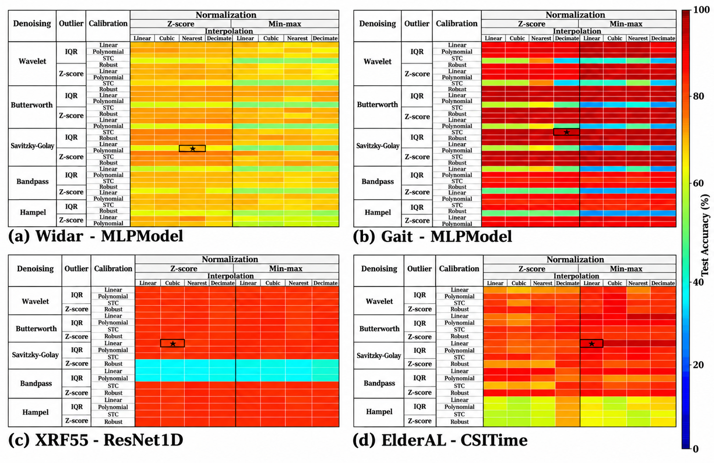

# Preprocessing Matters
### A Pluggable Benchmark for Heterogeneous WiFi CSI Sensing


**Preprocessing Matters** is a preprocessing-centric benchmark for studying how signal transformations affect deep learning-based WiFi Channel State Information (CSI) sensing. Instead of treating preprocessing as a fixed implementation detail, this work studies it as an experimental variable across **four heterogeneous datasets**, **19 registered learning models**, and **five preprocessing stages**.

The benchmark combines comparisons of predefined pipelines with fine-grained analyses of individual operations. Its central question is not merely *which combination achieves the highest accuracy*, but **when, why, and for which signals and models a preprocessing operation helps or hurts**.

> **Associated manuscript:** *Preprocessing matters: A pluggable benchmark for heterogeneous WiFi CSI sensing*. Publication details and a permanent code release identifier will be added when available.

**Navigation:** [Overview](#overview) · [Datasets](#datasets) · [Preprocessing](#preprocessing-library) · [Benchmark](#evaluation-protocol) · [Quick start](#getting-started) · [Experiments](#running-the-experiments) · [Results](#results-and-visualizations) · [Citation](#citation-and-acknowledgments)

## Overview

Our benchmark separates **dataset representation**, **preprocessing configuration**, and **learning architecture** to make preprocessing effects observable and comparable.

```text
Public WiFi CSI datasets
          |
          v
Dataset-specific parsing and group-aware data splitting
          |
          v
Configurable preprocessing
  Denoising -> Outlier handling -> Phase calibration*
            -> Normalization -> Interpolation
          |
          v
Unified model training and evaluation
          |
          +--> Stage I: preprocessing presets × learning models
          |
          +--> Stage II: fine-grained operator combinations
          |
          v
Signal-level diagnostics and preprocessing recommendations

* Phase calibration is evaluated for complex-valued CSI.
```

This repository provides a registry-based preprocessing library, experiment scripts for four sensing tasks, a library of 19 neural models, saved performance summaries, figure-generation code, and mechanism studies of sampling, outlier handling, filtering, signed normalization, and phase structure.

## Datasets

Four previously published WiFi sensing datasets are included in the study. Their different sensing tasks and signal representations are part of the experimental design.

| Dataset | Task | Representation used in this study | Group / partition variable |
| --- | --- | --- | --- |
| **Widar** | Gesture recognition | Complex CSI, represented using amplitude and phase | Position, orientation, receiver |
| **Gait** | User identification | Complex CSI, represented using amplitude and phase | Walking track, receiver |
| **XRF55** | Human activity recognition | Real-valued amplitude input | Repetition ID |
| **ElderAL** | Human activity recognition | Real-valued amplitude input | Acquisition position |

**Data representation matters.** The descriptions above refer to the input variants used in *these experiments*, not every data format offered by the original dataset authors. In particular, the XRF55 `.npy` files in the evaluated path contain real-valued input; the XRF55 experiments also restrict the selected users to the first three. Results from this subset must not be described as full-XRF55 results.

The original datasets are **not packaged in this repository**. Obtain them from their providers or consult the dataset access information in the [SDP project](https://github.com/yuanhao-cui/SDP-Sensing-Data-Protocol-for-Scalable-Wireless-Sensing). Please cite the corresponding dataset publications.

## Preprocessing library

The framework implements an extensible registry for selecting algorithms, changing parameters, composing pipelines, and registering new operators.

| Preprocessing stage | Evaluated methods |
| --- | --- |
| Denoising | Wavelet, Butterworth, Savitzky–Golay, band-pass, Hampel |
| Outlier handling | IQR-based and Z-score-based detection |
| Phase calibration | Linear, polynomial, STC, robust phase sanitization |
| Normalization | Z-score, min–max |
| Interpolation | Linear, cubic, nearest-neighbor, anti-aliased decimation |

The nominal processing order is **denoising → outlier handling → phase calibration → normalization → interpolation**. Some experimental scripts implement dataset-specific safeguards and processing order adjustments, especially for input normalization and complex-to-real feature representations; consult the actual experiment script for precise reproduction.

Phase calibration is part of the Widar and Gait fine-grained evaluations. It is not varied for real-amplitude XRF55 and ElderAL. Numerically valid operations are not automatically physically appropriate: sampling frequency, time-window span, signed changes, and relationships across subcarriers can change the meaning of a transformation.

### Pluggable API

After installation, a registered preprocessing preset can be inspected and applied as follows:

```python
from wsdp.algorithms import apply_preset, execute_pipeline, list_presets

print(list_presets())
steps = apply_preset("high_quality")

# `csi` is a CSI array loaded using an appropriate dataset reader.
processed_csi = execute_pipeline(csi, steps, dataset="widar")
```

The six registered presets are `high_quality`, `fast`, `robust`, `gesture_recognition`, `activity_detection`, and `localization`. Their exact parameters are defined in [the algorithm registry](SDP/SDP-Sensing-Data-Protocol-for-Scalable-Wireless-Sensing-main/src/wsdp/algorithms/registry.py).

## Evaluation protocol

### Stage I — Preprocessing–model sensitivity

Stage I evaluates six predefined preprocessing presets over a model registry of 19 architectures on the four datasets. Architectures span MLP, convolutional and recurrent baselines, residual and attention networks, Transformer- and Mamba-based models, and CSI-specific approaches such as CSITime, WiFlexFormer, and FewSense. See [the model library](SDP/SDP-Sensing-Data-Protocol-for-Scalable-Wireless-Sensing-main/src/wsdp/models/__init__.py).

The nominal design is **6 presets × 19 models per dataset**, but the number of completed evaluations may be smaller due to explicitly excluded models, runtime failures, or other coverage limitations. **Failed and skipped runs are not zero-accuracy measurements.**

### Stage II — Fine-grained preprocessing combinations

Stage II holds a representative model and its training/evaluation protocol fixed while varying preprocessing configurations.

| Dataset | Representative model | Combination design | Grid size |
| --- | --- | --- | ---: |
| Widar | MLPModel | 5 denoisers × 2 outlier methods × 4 phase methods × 2 normalization methods × 4 interpolation methods | **320** |
| Gait | MLPModel | 5 × 2 × 4 × 2 × 4 | **320** |
| XRF55 | ResNet1D | 5 denoisers × 2 outlier methods × 2 normalization methods × 4 interpolation methods | **80** |
| ElderAL | CSITime | 5 × 2 × 2 × 4 | **80** |

These are the **defined configuration grids**, not a guarantee that every stored run has completed successfully. Dataset subsets, group assignments, models, random seeds, and hyperparameters must be inspected in the referenced scripts when comparing experiments.

## Getting started

### 1. Clone and install

The nested SDP package declares Python **3.9 or later** and uses PyTorch. GPU acceleration is recommended for large training sweeps.

```bash
git clone https://github.com/Jinkai-Hu4514/Preprocessing_matters.git
cd Preprocessing_matters

python -m venv .venv
# Activate the virtual environment using your operating system's command.
python -m pip install -e ./SDP/SDP-Sensing-Data-Protocol-for-Scalable-Wireless-Sensing-main
```

The editable installation uses dependencies declared in the nested [`pyproject.toml`](SDP/SDP-Sensing-Data-Protocol-for-Scalable-Wireless-Sensing-main/pyproject.toml). See also the [requirements file](SDP/SDP-Sensing-Data-Protocol-for-Scalable-Wireless-Sensing-main/requirements.txt). Some standalone diagnostic scripts may import additional analysis packages.

### 2. Prepare dataset paths

The existing experiment scripts use the following directory structure. `sdp_dataset/` is local and ignored by Git.

```text
Preprocessing_matters/
├── SDP/
├── sdp_dataset/                 # Supplied by the user; not committed
│   ├── widar_common3/           # Widar data
│   ├── Gait_Dataset/
│   │   └── CSI_Gait/            # Gait data
│   ├── xrf55/                   # XRF55 data
│   └── elderAL/                 # ElderAL data
├── ablation/
└── paper_figures/
```

These are **paths expected by the scripts**, not necessarily the names of the originally downloaded archives. Adjust or organize your data locally before running a benchmark.

### 3. Run one configuration first

Before launching a large sweep, check `DATA_PATH`, dataset selection, model selection, device settings, and training hyperparameters at the top of a single-run script. For example:

```bash
python SDP/test_elderAL/pipline_elderAL_steps.py
```

The spelling `pipline_elderAL_steps.py` is intentional because it is the existing filename. Corresponding single-configuration scripts are present for the other three datasets.

## Running the experiments

All commands below are issued from the **repository root**, after installing the package and supplying the datasets. They train models and may consume substantial GPU time.

### Stage I: Preset–model sweeps

```bash
python SDP/test_wider/full_test_presets_models_widar.py
python SDP/test_gait/full_test_presets_models_gait.py
python SDP/test_xrf55/full_test_presets_models_xrf55.py
python SDP/test_elderAL/full_test_presets_models_elderAL.py
```

### Stage II: Fine-grained sweeps

```bash
python SDP/test_wider/full_test_widar_new.py
python SDP/test_xrf55/full_test_xrf55.py
python SDP/test_elderAL/full_test_elder.py
```

Gait's optimized Stage II implementation includes environment variables for the requested combination range. Its checked-in defaults cover only a **subrange** of the full 320 combinations. To request all combinations in a Unix-like shell:

```bash
GAIT_COMBO_START=1 GAIT_COMBO_END=320 \
  python SDP/test_gait/full_test_gait_new.py
```

On Windows, set the two environment variables using the appropriate PowerShell or Command Prompt syntax. Scripts may also hard-code CUDA visibility, worker counts, padding lengths, and output names. Review these settings before execution and inspect previous summaries before rerunning a sweep.

## Results and visualizations

Benchmark scripts primarily save summaries and run-specific outputs in their respective `SDP/test_*/result/` directories. Additional resources include:

- [`paper_figures/`](paper_figures/) — figure-generation scripts, derived result tables, and available plots.
- [`ablation/`](ablation/) — signal-level and targeted ablation analyses for Hampel, band-pass filtering, phase calibration, and related effects.
- [`paper_figures/figure_manifest.json`](paper_figures/figure_manifest.json) — provenance information for supported figure-generation workflows.



*Stage II: Test accuracy across fine-grained preprocessing combinations for Gait and Widar (320 configurations each), XRF55 and ElderAL (80 configurations each). Rows vary denoising, outlier handling, and (for complex CSI) phase calibration; columns vary normalization and interpolation. This README preview is reconstructed from the repository's result summaries. 

## Repository structure

```text
Preprocessing_matters/
├── README.md
├── .gitignore
├── SDP/
│   ├── SDP-Sensing-Data-Protocol-for-Scalable-Wireless-Sensing-main/
│   │   ├── src/wsdp/           # Data readers, algorithms, models, utilities
│   │   ├── examples/
│   │   ├── requirements.txt
│   │   └── pyproject.toml
│   ├── test_wider/             # Widar experiments
│   ├── test_gait/              # Gait experiments
│   ├── test_xrf55/             # XRF55 experiments
│   └── test_elderAL/          # ElderAL experiments
├── ablation/                  # Signal investigations and ablation scripts
├── paper_figures/             # Plot scripts, derived data, figures
├── output/                    # Supplementary generated material
├── outputs/                   # Additional analysis outputs
└── result/                    # Additional experiment outputs
```

Some historical analyses and intermediate experiment artifacts remain in the research repository. For scientific reuse, identify the precise script, dataset subset, configuration, summary, and commit associated with the reported result.

## Main observations

The benchmark and follow-up signal analyses motivate four observations:

1. **Preprocessing effects depend jointly on data properties and model architecture.** A configuration that helps one data representation or learner need not improve another.
2. **Frame-domain locality does not guarantee time-domain locality.** Irregularly spaced CSI samples make nominal frame windows span different amounts of physical time.
3. **Filtering needs physically appropriate settings and signal semantics.** Sampling-rate assumptions, short-sequence behavior, and the treatment of signed values can change the actual operation.
4. **Nuisance suppression should preserve relational structure.** Independent phase detrending may disturb cross-subcarrier relationships relevant to sensing.

These statements are findings from the studied datasets and implementations, not universal rankings of preprocessing algorithms. The supporting tests, visualizations, and diagnostic code are provided in the accompanying experiment and ablation directories.

## Reproducibility notes

- **Splitting:** Do not substitute unrestricted random frame splits for the dataset-specific, group-aware protocols.
- **Representation:** Complex CSI, amplitude-only input, and converted amplitude/phase channels have different semantics.
- **Parameters:** Inspect sampling frequency, filter coverage, outlier window definitions, phase transformations, and operator ordering.
- **Evaluation:** Record exactly which runs completed and keep failed/skipped configurations distinguishable from low accuracy.
- **Traceability:** Retain dataset subsets, seeds, model configurations, training budgets, and code revision identifiers.

## Citation and acknowledgments

**Associated paper:** *Preprocessing matters: A pluggable benchmark for heterogeneous WiFi CSI sensing*. Formal bibliographic information and a permanent release DOI will be added when available.

This research repository incorporates and extends the open-source infrastructure of [**SDP: Sensing Data Protocol for Scalable Wireless Sensing**](https://github.com/yuanhao-cui/SDP-Sensing-Data-Protocol-for-Scalable-Wireless-Sensing). The retained source package contains its own project-level documentation and license. The present study centers on the **systematic evaluation and diagnostic analysis of pluggable WiFi CSI preprocessing**.

For a related open-source model benchmarking project, see [**SenseFi**](https://github.com/xyanchen/WiFi-CSI-Sensing-Benchmark). Cite the original publications associated with the four datasets as appropriate.

## Questions and issues

To report a bug or ask a reproducibility question, [open an issue](https://github.com/Jinkai-Hu4514/Preprocessing_matters/issues) and include the dataset, script, preprocessing configuration, model name, relevant environment information, and error message or summary row.

**Repository:** https://github.com/Jinkai-Hu4514/Preprocessing_matters
